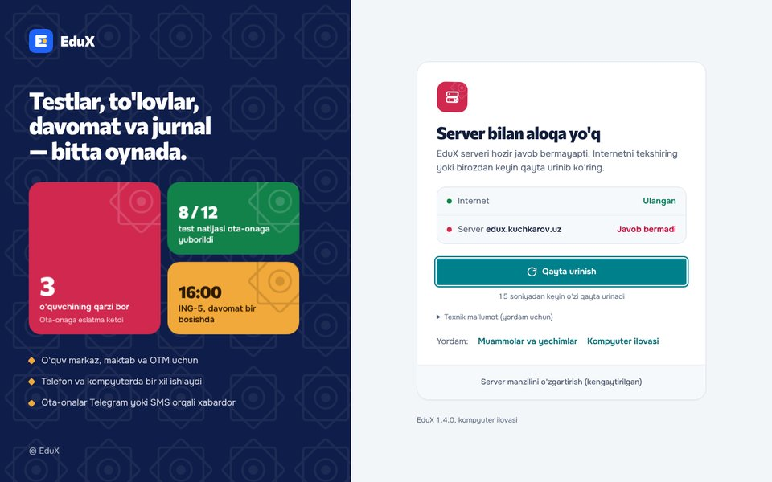
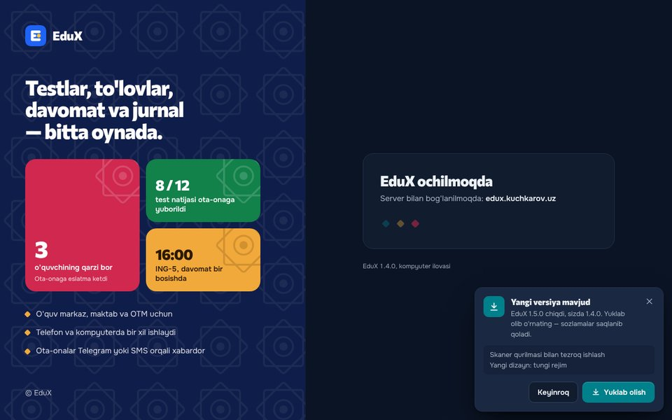
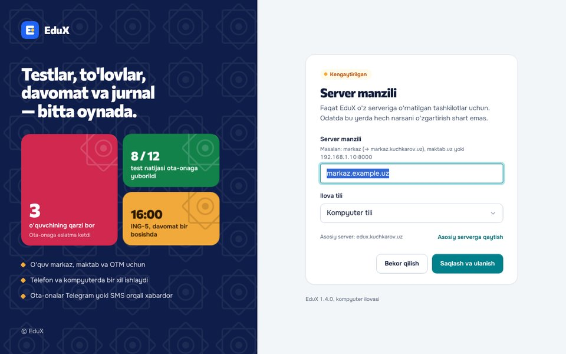
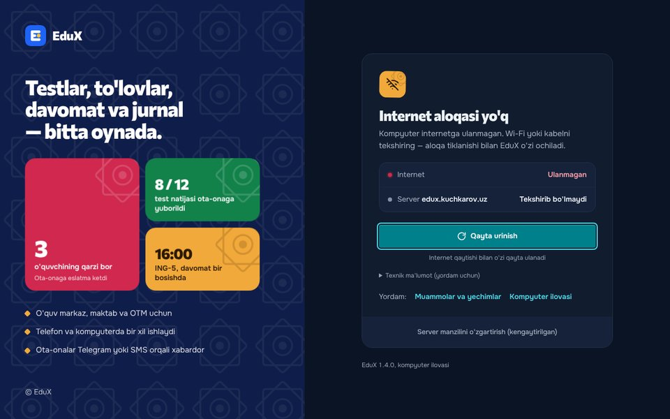

# EduX — kompyuter ilovasi (Windows, macOS, Linux)

EduX tizimining kompyuter uchun ilovasi. Ilova tanlangan EduX serverining veb ilovasini o'z oynasida ochadi,
shuning uchun **hamma rollar** — platforma egasi, direktor, administrator, kassir, marketolog, o'qituvchi,
o'quvchi va ota-ona — brauzerdagidek bir xil imkoniyatlarga ega bo'ladi, ustiga kompyuter ilovasining qulayliklari qo'shiladi.

Texnologiya: [Tauri v2](https://v2.tauri.app) (Rust + tizimning o'z WebView'i: Windows — WebView2, macOS — WKWebView,
Linux — WebKitGTK). O'rnatuvchi hajmi kichik (3–12 MB), alohida brauzer qo'shib berilmaydi.

## Imkoniyatlar

- **Manzil so'ralmaydi.** Ilova ochilishi bilan asosiy serverning kirish sahifasi (`<server>/login`) ochiladi —
  foydalanuvchi faqat telefon raqami va parolini kiritadi. Asosiy server yig'ish paytida beriladi (pastda «Asosiy server»).
- **O'z serveri bo'lgan mijozlar uchun (kengaytirilgan):** menyu → **EduX → Kengaytirilgan → Server manzili…** —
  subdomen (`markaz` → `https://markaz.<asosiy server domeni>`), domen (`maktab.uz`) yoki IP (`192.168.1.10:8000`);
  saqlashdan oldin `GET <server>/api/v1/auth/options` bilan tekshiriladi. «Asosiy serverga qaytish» tugmasi bor.
- **Til:** o'zbekcha / ruscha / inglizcha — kompyuter tiliga qarab, sozlamalarda qo'lda tanlash mumkin.
- **Oyna** o'lchami va joyi eslab qolinadi; ilova **bitta nusxada** ishlaydi (qayta ochilsa, mavjud oyna oldinga chiqadi).
- **Havolalar:** o'sha server ilova ichida; tashkilot subdomenlari — server o'zi aytgan asosiy domen bo'yicha
  (`GET <server>/api/v1/site` → `domain`; domen berilmagan serverda — faqat aynan shu manzil, `co.uz` kabi ommaviy
  qo'shimchalar ostidagi qo'shni saytlar hech qachon «o'ziniki» hisoblanmaydi). Boshqa saytlar, `mailto:`, `tel:`,
  Telegram — tizim brauzeri/ilovasida.
  `target="_blank"` va `window.open` bilan ochiladigan o'sha server sahifalari (kartalarni chop etish, sertifikat) — yangi ilova oynasida.
- **Fayllarni yuklab olish** (Excel, PDF, ZIP): blob/`<a download>` va server yuborgan `attachment` javoblar —
  tizimning **«Saqlash»** oynasi orqali; saqlangach bildirishnoma chiqadi.
- **Chop etish** (`window.print()` — kvitansiya, tabel, javob varaqalari, kartalar) — tizimning chop etish oynasi.
- **Bildirishnomalar:** veb ilovadagi `Notification` → Windows/macOS/Linux bildirishnomasi.
- **Kamera va mikrofon** (Face ID kiosk, QR, call-markaz) — tanlangan server uchun ruxsat beriladi
  (macOS birinchi marta tizim ruxsatini so'raydi).
- **Deep link:** `edux://open?path=/students/5` — ilovani ochadi va shu sahifaga o'tadi (uchala OS da sxema ro'yxatdan o'tadi).
- **Menyu:** Qayta yuklash (Ctrl+R), Orqaga/Oldinga, Kattalashtirish/Kichiklashtirish/Asl o'lcham (Ctrl +/−/0),
  To'liq ekran, Kengaytirilgan → Server manzili…, Brauzerda ochish, Yangilanishni tekshirish, EduX haqida (ilova va
  server versiyasi). **Yordam** (1.2.0): «Yordam markazi» (F1 → `<server>/help`), «Ko'p beriladigan savollar»
  (`/yordam/kop-beriladigan-savollar`), «Murojaat yuborish» (`/support?from=<joriy sahifa>`). Server sahifasi ochiq
  bo'lmasa (aloqa yo'q) — ulangach shu sahifaga o'tiladi.
- **Veb bilan kelishuv** (1.2.1, server 1.38): ilova sahifaga `window.__EDUX_DESKTOP__ = {platform, version}` beradi —
  veb shuni o'qib, ilova ichida «Yuklab olish» tugmalarini yashiradi va murojaat (`POST /api/v1/public/support`)
  kontekstiga `app=desktop` va ilova versiyasini o'zi yozadi. Ilova so'rovlarga aralashmaydi (1.2.0 dagi fetch/XHR
  orqali qo'shish olib tashlandi — kontekst ikki marta yozilmaydi). Sozlamalar yorliqlari (`?tab=`) — veb manzilining
  bir qismi, ilova ichida ham, «Brauzerda ochish» da ham saqlanadi.
- **Internet yo'q / server ochilmasa** — tushunarli sahifa: nima bo'ldi («Internet aloqasi yo'q», «Server bilan aloqa yo'q»
  yoki «Bu manzilda EduX topilmadi»), holat ro'yxati (Internet — ulangan/ulanmagan, Server — javob bermadi), katta
  «Qayta urinish» tugmasi. Ilova o'zi ham qayta urinadi (15, 30, keyin har 60 soniyada), internet qaytishi bilan darhol ulanadi.
  «Texnik ma'lumot» — yordam uchun xato matni; «Yordam: Muammolar va yechimlar · Kompyuter ilovasi» — ochiq yordam
  markazi maqolalari brauzerda (`<server>/yordam/<slug>`); pastida «Server manzilini o'zgartirish (kengaytirilgan)».
  Ish vaqtida internet uzilsa (1.1.1) — sahifa tepasida «Internet aloqasi yo'q» belgisi (veb tokenlari bilan), sahifa
  yopilmaydi; aloqasiz F5/Ctrl+R sahifani WebView xato oynasiga almashtirmaydi.
- **Skaner qurilmasi** (USB/Bluetooth QR yoki shtrix-kod, klaviatura rejimi) veb sahifadagidek ishlaydi: tugma hodisalari
  WebView'ga to'g'ridan-to'g'ri keladi, ilova ularni ushlab qolmaydi (menyu tugmalari faqat Ctrl/Cmd/Alt/F bilan).
  Linux (WebKitGTK) da haqiqiy ilovada sinalgan: 8 ms/belgi tezlikdagi kod + Enter/NumpadEnter tutiladi, sekin yozuv
  (200 ms) skaner deb olinmaydi, rus joylashuvida ham `event.code` to'g'ri (`У` → `KeyE`), kod lotincha tiklanadi.
- **Yangi versiya:** ishga tushganda va har 6 soatda `GET <server>/api/v1/public/apps` so'raladi;
  `desktop.windows|macos|linux.version` joriy versiyadan yangi bo'lsa, pastki burchakda «Yangi versiya mavjud» xabari
  chiqadi: «EduX 1.2.0 chiqdi, sizda 1.1.0…», izoh (`notes`), «Keyinroq» va «Yuklab olish». «Yuklab olish» serverdagi
  **doimiy havolani** brauzerda ochadi: `<server>/download/windows|macos|linux` (Linux'da .deb dan o'rnatilgan bo'lsa —
  `/download/linux/deb`); server faylni o'zi beradi yoki GitHub relizga yo'naltiradi. Platforma yashirilgan, versiya
  kiritilmagan yoki endpoint yo'q (404) bo'lsa — hech narsa chiqmaydi.
- **Dizayn** (1.4.0) — veb tizimning 1.41 **«Koshin»** dizayni (v3; 1.3.0 dagi «Daftar» — daftar varag'i, qizil hoshiya,
  ruchka chizig'i, Literata va Golos Text — butunlay olib tashlandi). Keng oynada chapda **«lojuvard tun» paneli**: oq
  girih yulduzlari naqshi, katta sarlavha va tizimdan uch lahza — to'liq rangli **koshin plitkalar** (qarz — anor, test
  natijasi — pista, dars — shafran), xuddi veb kirish sahifasidagidek; o'ngda — oq sir kanvasdagi karta. Holat belgisi
  to'liq rangli plitka, muhr kabi bosiladi (aloqa yo'q — anor, internet yo'q — shafran); yuklanish belgisi — uch koshin
  romb navbat bilan «nafas oladi». Sarlavha va raqamlar **Commissioner**, matn **Onest** (lotin va kirill; o'zbekcha ʻ —
  Commissioner'dan) — ilova ichida, internetsiz ham (`ui/fonts`, OFL). Ranglar `docs/design.md` jadvalidan (Koshin,
  Feruza; tungi rejim — «lojuvard tun», kompyuter sozlamasiga qarab). Harakatni kamaytirish yoqilgan bo'lsa — harakatsiz.
  Yangilanish xabari va «Internet aloqasi yo'q» belgisi veb v3 tokenlaridan (`--raised`, `--ink`, `--accent`,
  `--font-display`, `--warning-solid`; eski serverda eski nomlar, keyin Koshin/Feruza qiymatlari) — tashkilot shabloni,
  rangi va tungi rejimiga moslashadi. Ilova ikonkalari o'zgarmagan.

| Kunduzgi | Tungi |
|---|---|
|  |  |
|  |  |

Rasmlar `ui/index.html` ni brauzerda (Playwright, Tauri IPC soxtasi bilan) ochib olingan.

Javob namunasi:

```json
{ "desktop": {
    "windows": { "version": "1.1.0", "url": "https://…/EduX-Setup-x64.exe", "notes": "…" },
    "macos":   { "version": "1.1.0", "url": "https://…/EduX-macOS-universal.dmg" },
    "linux":   { "version": "1.1.0", "url": "https://…/EduX-linux-x86_64.AppImage" } } }
```

## Yuklab olish (o'zgarmas havolalar)

Har `main` ga push'dan keyin GitHub Actions o'rnatuvchilarni **`desktop-latest`** relizga bir xil nomlar bilan qo'yadi —
havolalar hech qachon o'zgarmaydi:

| Tizim | Fayl | Havola |
|---|---|---|
| Windows 10/11 (o'rnatuvchi) | `EduX-Setup-x64.exe` | https://github.com/Azamat4588/edux-desktop/releases/download/desktop-latest/EduX-Setup-x64.exe |
| Windows (MSI, korporativ) | `EduX-x64.msi` | https://github.com/Azamat4588/edux-desktop/releases/download/desktop-latest/EduX-x64.msi |
| macOS 10.15+ (Intel va Apple Silicon) | `EduX-macOS-universal.dmg` | https://github.com/Azamat4588/edux-desktop/releases/download/desktop-latest/EduX-macOS-universal.dmg |
| Linux (har qanday distributiv) | `EduX-linux-x86_64.AppImage` | https://github.com/Azamat4588/edux-desktop/releases/download/desktop-latest/EduX-linux-x86_64.AppImage |
| Ubuntu / Debian | `EduX-linux-amd64.deb` | https://github.com/Azamat4588/edux-desktop/releases/download/desktop-latest/EduX-linux-amd64.deb |

Versiya o'zgarganda (`package.json` → `version`) alohida **`v<versiya>`** relizi ham yaratiladi va «Latest» bo'ladi —
`https://github.com/Azamat4588/edux-desktop/releases/latest/download/<fayl nomi>` ham doim oxirgi barqaror versiyaga olib boradi.
Har relizda `SHA256SUMS.txt` bor.

> **Muhim:** repozitoriy **private** bo'lsa, GitHub relizlaridagi fayllarni faqat repoga kirish huquqi borlar yuklay oladi.
> Foydalanuvchilarga tarqatish uchun: repozitoriyni public qiling yoki o'rnatuvchilarni EduX serverga
> (platforma admin → «Ilovalar» sahifasi) yuklab, `public/apps` javobida o'sha havolalarni bering.

## Imzosiz o'rnatishda foydalanuvchi nimani ko'radi

- **Windows:** SmartScreen «Windows protected your PC» deydi → **More info** (Подробнее) → **Run anyway** (Выполнить в любом случае).
  WebView2 Windows 10/11 da odatda bor; bo'lmasa o'rnatuvchi uni o'zi yuklab o'rnatadi.
- **macOS:** «Apple could not verify…» — birinchi marta ilovani Finder'da **o'ng tugma → Open (Открыть)**,
  yoki **System Settings → Privacy & Security → Open Anyway**. Keyingi ochishlar odatdagidek.
  (Ilova ad-hoc imzolangan, shuning uchun Apple Silicon'da «buzilgan» deb chiqmaydi.)
- **Linux AppImage:** `chmod +x EduX-linux-x86_64.AppImage && ./EduX-linux-x86_64.AppImage`
  (Ubuntu 22.04+ da `libfuse2` kerak bo'lishi mumkin: `sudo apt install libfuse2`).
  **.deb:** `sudo apt install ./EduX-linux-amd64.deb` — menyuda «EduX» paydo bo'ladi.
  Paket nomi `edux` (o'chirish: `sudo apt remove edux`).

## Imzo (ixtiyoriy) — GitHub Secrets

Secrets bo'lmasa yig'ish to'xtamaydi, shunchaki imzosiz chiqadi. Repo → Settings → Secrets and variables → Actions:

**Windows (kod imzosi sertifikati, OV/EV .pfx):**

- `WINDOWS_CERT_PFX_BASE64` — `.pfx` fayl base64 ko'rinishida (`base64 -w0 cert.pfx`, Windows: `[Convert]::ToBase64String([IO.File]::ReadAllBytes("cert.pfx"))`)
- `WINDOWS_CERT_PASSWORD` — `.pfx` paroli

CI sertifikatni import qiladi va `.exe`/`.msi` ni SHA-256 + timestamp bilan imzolaydi. (EV sertifikat odatda
apparat kalitda bo'ladi — u holda Azure Trusted Signing yoki `signCommand` kerak; README ni yangilang.)

**macOS (Apple Developer Program, yiliga $99):**

- `APPLE_CERTIFICATE` — «Developer ID Application» sertifikati `.p12` base64 ko'rinishida
- `APPLE_CERTIFICATE_PASSWORD` — `.p12` paroli
- `APPLE_SIGNING_IDENTITY` — masalan `Developer ID Application: EduX LLC (TEAMID1234)`
- Notarizatsiya: `APPLE_ID` (Apple ID email), `APPLE_PASSWORD` (app-specific password, appleid.apple.com → Sign-In and Security),
  `APPLE_TEAM_ID`

Hammasi berilsa `.dmg` imzolanadi va notarizatsiyadan o'tadi — foydalanuvchi hech qanday ogohlantirish ko'rmaydi.

### Avtomatik (jim) yangilanishni keyin yoqish

Hozir ilova faqat banner ko'rsatadi. Tauri updater'ni yoqish uchun:

1. `npx tauri signer generate -w ~/.tauri/edux.key` — kalit juftligi (maxfiy kalit + parol `TAURI_SIGNING_PRIVATE_KEY`,
   `TAURI_SIGNING_PRIVATE_KEY_PASSWORD` secrets'ga).
2. `tauri-plugin-updater` ni qo'shish, `tauri.conf.json` → `plugins.updater.pubkey` va `endpoints`
   (masalan `https://github.com/Azamat4588/edux-desktop/releases/latest/download/latest.json`),
   `bundle.createUpdaterArtifacts: true`.
3. CI'da `latest.json` (versiya, imzolar, URL'lar) yaratib relizga qo'shish. Windows/macOS da kod imzosi ham bo'lgani ma'qul.

## Asosiy server (domen tayyor bo'lganda)

Ilova ochadigan server **yig'ish paytida** beriladi: repozitoriy o'zgaruvchisi `EDUX_SERVER`.
Bo'lmasa — `https://edux.kuchkarov.uz`.

1. GitHub → **Azamat4588/edux-desktop → Settings → Secrets and variables → Actions → Variables → New repository variable**:
   nomi `EDUX_SERVER`, qiymati masalan `https://edux.kuchkarov.uz` (oxirida `/` siz).
2. **Actions → Desktop → Run workflow** (yoki `main` ga istalgan push) — yangi o'rnatuvchilar shu server bilan chiqadi.

Foydalanuvchi o'zi «Kengaytirilgan → Server manzili…» orqali boshqa server tanlamagan bo'lsa, ilova doim yig'ishdagi
asosiy serverga ergashadi. Sozlamalar fayli: `%APPDATA%\uz.edux.desktop\settings.json` /
`~/Library/Application Support/uz.edux.desktop/settings.json` / `~/.config/uz.edux.desktop/settings.json`.

## Mahalliy yig'ish

Talablar: Node.js 20+, Rust (stable), va OS kutubxonalari:

- **Linux (Ubuntu/Debian):** `sudo apt install libwebkit2gtk-4.1-dev libgtk-3-dev libayatana-appindicator3-dev librsvg2-dev patchelf`
- **Windows:** Visual Studio Build Tools (C++), WebView2 (Windows 10/11 da bor)
- **macOS:** Xcode Command Line Tools (`xcode-select --install`)

```bash
npm ci
npx tauri dev                       # ishlab chiqish rejimi
EDUX_SERVER=https://edux.kuchkarov.uz npx tauri build    # o'rnatuvchilar: src-tauri/target/release/bundle/
cd src-tauri && cargo test          # birlik testlari (manzil, versiya taqqoslash)
```

Belgilar (ikonka) `src-tauri/icons/source.png` dan (mobil ilova logotipi asosida): `npm run icons`.

## Tuzilishi

```
ui/                     ilovaning o'z sahifasi: yuklanish, aloqa yo'q, kengaytirilgan server manzili (uz/ru/en)
ui/fonts/               Commissioner va Onest shriftlari (OFL), ekranlar internetsiz ham to'g'ri chiziladi
docs/screens/           README rasmlari (ilova ekranlari, kunduzgi/tungi)
src-tauri/src/lib.rs    oyna, menyu, navigatsiya, yuklab olish, ruxsatlar, deep link, yangilanishlar
src-tauri/src/inject.js veb ilova ichiga qo'shiladigan ko'prik (blob yuklab olish, print, Notification, window.open)
src-tauri/src/settings.rs  sozlamalar, manzilni normallashtirish
src-tauri/src/net.rs    auth/options va public/apps so'rovlari, versiya taqqoslash
src-tauri/capabilities/ IPC ruxsatlari: ilova sahifasi va server sahifasi (faqat kerakli buyruqlar)
.github/workflows/desktop.yml   Windows/macOS/Linux yig'ish va relizlar
```

Xavfsizlik: server sahifasi faqat 5 ta buyruqni chaqira oladi (fayl saqlash, chop etish, bildirishnoma,
tashqi havola, yangi oyna); har buyruq chaqiruvchi sahifa tanlangan server ekanini qayta tekshiradi.
Boshqa saytlar ilova oynasida ochilmaydi.
